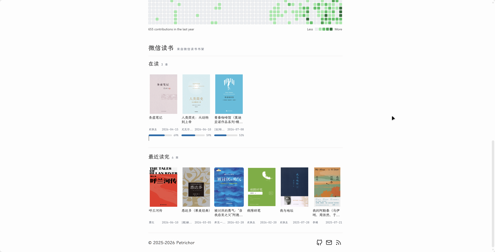

# WeRead Reading API（Cloudflare Workers）

这个 Worker 把 `weread-skills` 的微信读书调用封装成一个可供静态博客读取的 JSON API。[示例页面](https://blog.telyra.top/about/)

当前适配官方 skill **1.0.5**。书籍的 `readerLink` 是阅读器入口，`deepLink` 是详情入口；前端打开阅读时应优先使用 `readerLink`。



## 数据链路

1. 调用 `POST https://i.weread.qq.com/api/agent/gateway`，请求体必须把 `api_name`、业务参数和 `skill_version` 平铺在同一层。
2. 调用 `/shelf/sync` 获取书架：电子书在 `books[]`，有声书/专辑在独立的 `albums[]`。
3. 默认对未读完电子书调用 `/book/getprogress`，只有 `progress >= 10` 的书归入 `reading`；这样不会把书架中从未开始的书误判为在读。
4. 普通模式按 `readUpdateTime` 排序，最多为最近 5 本电子书补充进度、累计阅读秒数和读完日期；启用进度阈值时，会检查未读完电子书（最多 `PROGRESS_FILTER_LIMIT` 本）。
5. 严格的完成判断是 `progress=100` 且存在 `finishTime`。专辑的 `albumInfo.finish` 只表示音频目录是否完结，不代表用户已经听完，因此专辑单独放在 `audio`。

默认不暴露 `secret=1` 的私密书籍和专辑；只有显式设置 `INCLUDE_PRIVATE=true` 才会返回。

## API

### `GET /api/reading`

支持的查询参数：

- `status=all|reading|finished`：筛选返回的主列表，默认 `all`。
- `limit=1..500`：每个列表最多返回多少项，默认 100。
- `includeProgress=0`：当 `minProgress=0` 时关闭进度补充；默认阈值过滤需要进度数据，因此仍会检查未读完书籍。
- `minProgress=0..100`：在读最低进度，默认 10；传 `minProgress=0` 可恢复“所有未读完书籍”的旧行为。
- `progressFilterLimit=1..500`：进度过滤最多检查的未读完电子书数量，默认 100。

返回结构的核心字段：

```json
{
  "counts": {
    "shelfTotal": 12,
    "visibleTotal": 10,
    "ebooks": 8,
    "audio": 2,
    "reading": 5,
    "finished": 3
  },
  "reading": [{ "kind": "book", "bookId": "...", "title": "...", "status": "reading", "progressState": "reading" }],
  "finished": [{ "kind": "book", "bookId": "...", "title": "...", "status": "finished" }],
  "audio": [{ "kind": "audio", "albumId": "...", "catalogStatus": "ongoing" }]
}
```

时间字段已经按 skill 规范转换为 `YYYY-MM-DD`；阅读时长保留为秒字段 `readingTimeSeconds`，由前端格式化成小时/分钟。开启默认阈值后，`reading` 只包含已检查且 `progress >= 10` 的书；`meta.progressFilter.truncated=true` 表示书架未读完书超过检查上限，需提高 `progressFilterLimit`。最近有进度数据的书还会带 `progressState`：`not-started`、`reading` 或 `finished`。

### `GET /health`

返回 Worker 是否可达，不调用微信读书接口。

## 部署

需要 Node.js 和 Wrangler。Cloudflare 官方 SDK 文档提供了 `npx wrangler init` / `wrangler deploy` 工作流；本仓库已经提供最小配置。

```bash
npm install
npx wrangler secret put WEREAD_API_KEY
npm run typecheck
npm run dev
npm run deploy
```

`WEREAD_API_KEY` 只能通过 secret 设置，不要写进 `wrangler.toml` 或前端代码。`ALLOWED_ORIGIN` 支持逗号分隔的多个完整 origin；当前配置同时允许生产博客和 `http://localhost:4321`，本地调试结束后从 `wrangler.toml` 删除 localhost 即可。若希望博客额外携带令牌：

```bash
npx wrangler secret put BLOG_TOKEN
```

启用后，博客请求需带 `Authorization: Bearer <BLOG_TOKEN>` 或 `X-Api-Key`。静态博客中的令牌本身不是绝对机密；更安全的做法是只配置精确的 `ALLOWED_ORIGIN`，并仅发布你愿意公开的阅读数据。

## 静态博客调用示例

```js
const response = await fetch("https://weread-reading-api.<你的子域>.workers.dev/api/reading");
if (!response.ok) throw new Error("阅读数据暂时无法获取");
const data = await response.json();
renderReading(data.reading, data.finished, data.audio);
```

Worker 会返回 CORS 头，并设置 5 分钟的边缘缓存（可通过 `CACHE_TTL` 调整）。如果上游返回 `upgrade_info`，Worker 会返回 `503 upgrade_required`，此时应先按 skill 的升级指引更新版本。

## 升级与排查

官方技能安装/更新命令为 `npx skills add Tencent/WeChatReading -g`。这个命令只更新本地 Agent 的技能文件，不会修改或部署本项目的 Worker。

当 `/api/reading` 返回 `503 upgrade_required` 时，先阅读[官方最新版 SKILL.md](https://github.com/Tencent/WeChatReading/blob/main/skills/SKILL.md) 及 `shelf.md`、`book.md`，确认接口兼容性，再同步 `src/index.ts` 中的 `SKILL_VERSION` 并执行 `npm run typecheck`、`npm run deploy`。

博客的“微信读书数据暂时无法获取”是通用失败提示。排查时在浏览器 Network 中查看 `/api/reading` 的 HTTP 状态和 JSON 错误内容；`/health` 只检查 Worker 是否可达，不验证微信读书接口。
